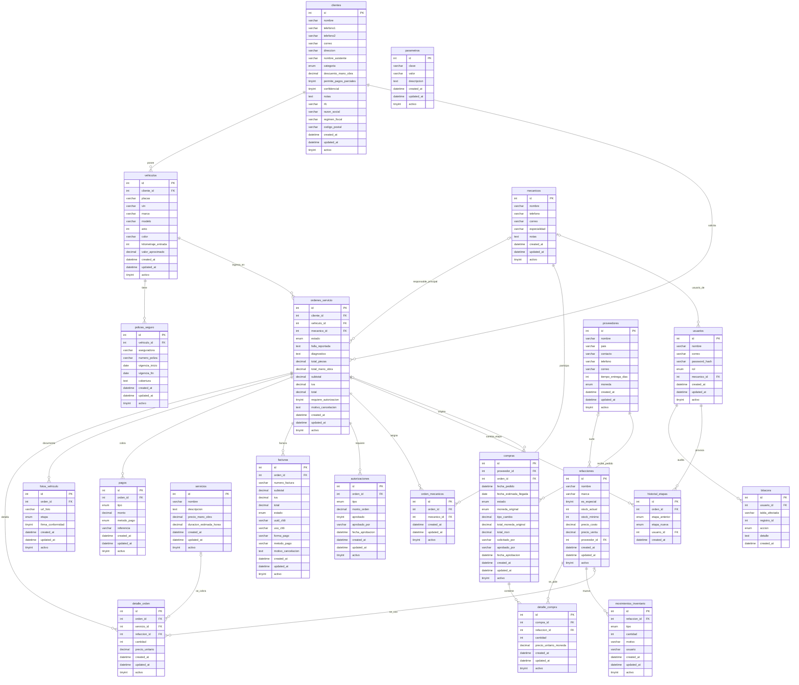

# Diagrama Entidad-Relación — AutoPulse Elite

Base de datos: `autopulse_elite` · MySQL 8.x · InnoDB · `utf8mb4_unicode_ci`

21 tablas. Cada tabla incluye `created_at`, `updated_at` y `activo` (borrado lógico), salvo los
logs inmutables `bitacora` e `historial_etapas`, que solo llevan `created_at` por diseño.

## Notas de diseño

### Cardinalidades

- `|o--o{` indica FK **opcional**: `mecanicos → ordenes_servicio.mecanico_id`,
  `mecanicos → usuarios.mecanico_id`, `proveedores → refacciones.proveedor_id`,
  `ordenes_servicio → compras.orden_id`, `servicios → detalle_orden.servicio_id` y
  `refacciones → detalle_orden.refaccion_id`.
- `||--o{` indica FK **obligatoria**.
- Todas las FK usan `ON DELETE RESTRICT` y `ON UPDATE CASCADE`. Nada se borra
  físicamente: el borrado es lógico con `activo = 0` (SEG-07).

### Reglas garantizadas en la base de datos

| Regla | Implementación |
|---|---|
| Detalle de orden: servicio **o** refacción, nunca ambos ni ninguno | Triggers `trg_detalle_orden_bi` / `trg_detalle_orden_bu` (MySQL no permite `CHECK` sobre columnas con FK y `ON UPDATE CASCADE`) |
| Bitácora inmutable (SEG-06) | Triggers `trg_bitacora_bu` / `trg_bitacora_bd` bloquean `UPDATE` y `DELETE` |
| Historial de etapas inmutable (ORD-06) | Triggers `trg_historial_etapas_bu` / `trg_historial_etapas_bd` |
| Un mecánico no se asigna dos veces a la misma orden | `UNIQUE (orden_id, mecanico_id)` en `orden_mecanicos` |
| Un usuario por correo | `UNIQUE (correo)` en `usuarios` |
| Factura sin folio duplicado ni UUID repetido | `UNIQUE (numero_factura)` y `UNIQUE (uuid_cfdi)`; ambos admiten múltiples `NULL` |

### Decisión sobre `ordenes_servicio.mecanico_id`

`ordenes_servicio.mecanico_id` identifica al **mecánico principal o responsable** de la orden.
La tabla `orden_mecanicos` guarda a **todos** los mecánicos que participan (ORD-09). El campo
es una referencia directa para consultas rápidas y para la pantalla de órdenes (ORD-03); la
tabla puente es la fuente completa de asignaciones.

### Trazabilidad

- `bitacora` registra altas, cambios, cancelaciones, autorizaciones y consultas a expedientes
  confidenciales (SEG-06, SEG-20), siempre con `usuario_id`, tabla y registro afectado.
- `movimientos_inventario` es el libro de entradas, salidas y ajustes de refacciones (INV-02, INV-05).
- `historial_etapas` permite calcular los días transcurridos en la etapa actual (ORD-06) y
  auditar retrocesos, que solo el administrador puede hacer (ORD-05).

### Parámetros configurables

`parametros` guarda valores de negocio sin recompilar:

| clave | valor | requisito |
|---|---|---|
| `tolerancia_reautorizacion` | `5` | AUT-08 (porcentaje antes de pedir reautorización) |
| `umbral_piezas_caras` | `25000` | PAG-06 (MXN para exigir 50% de anticipo) |
